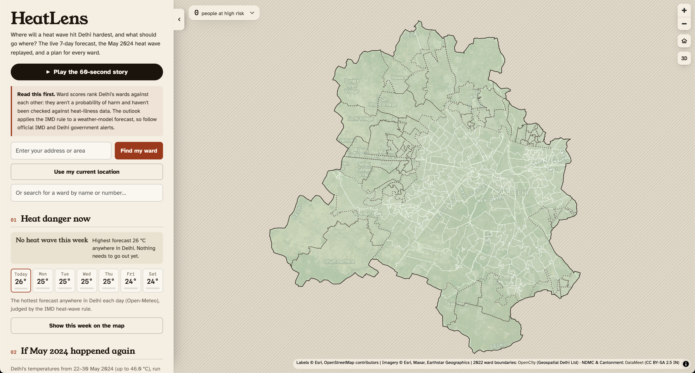
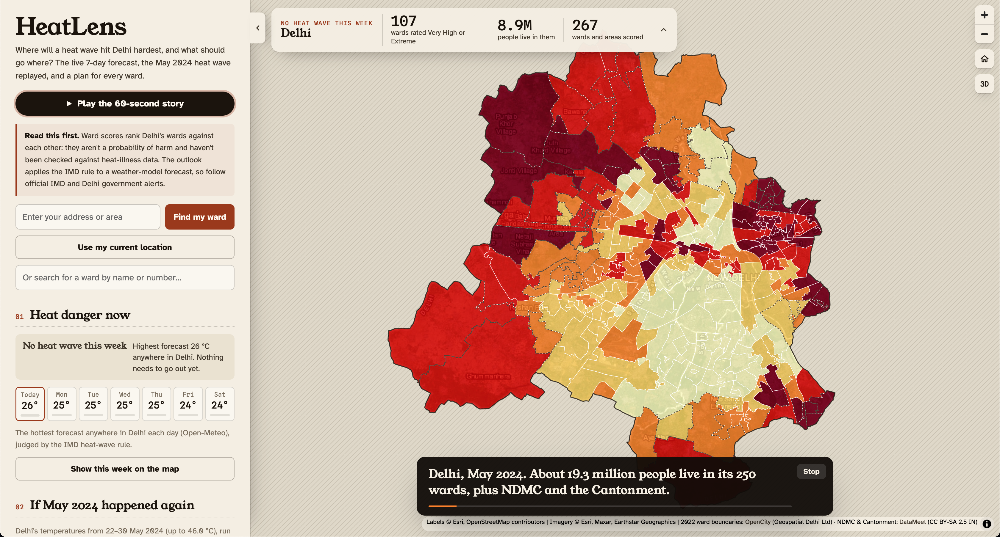
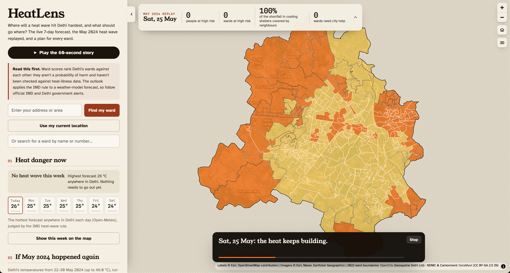
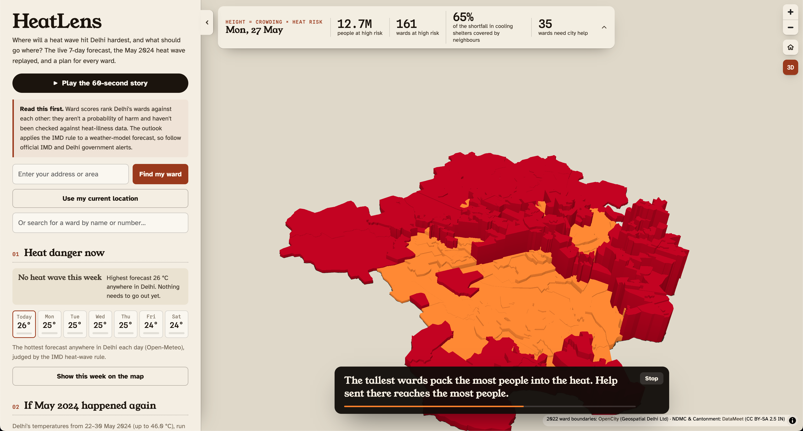
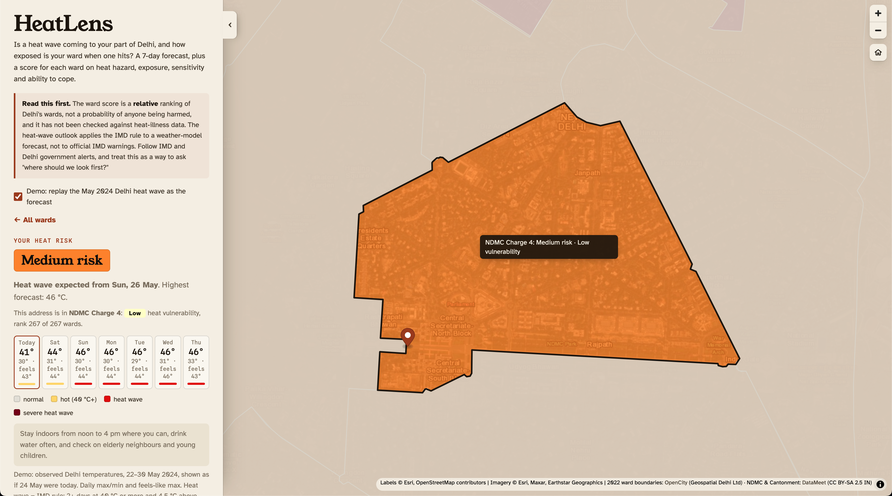
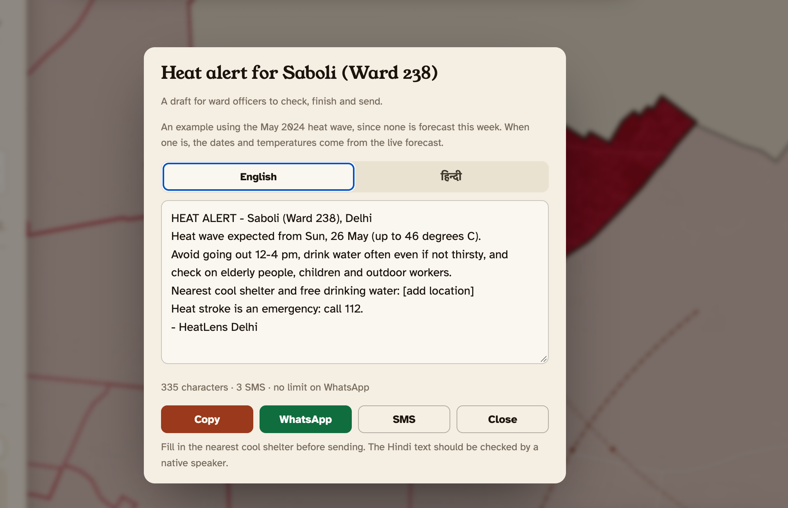
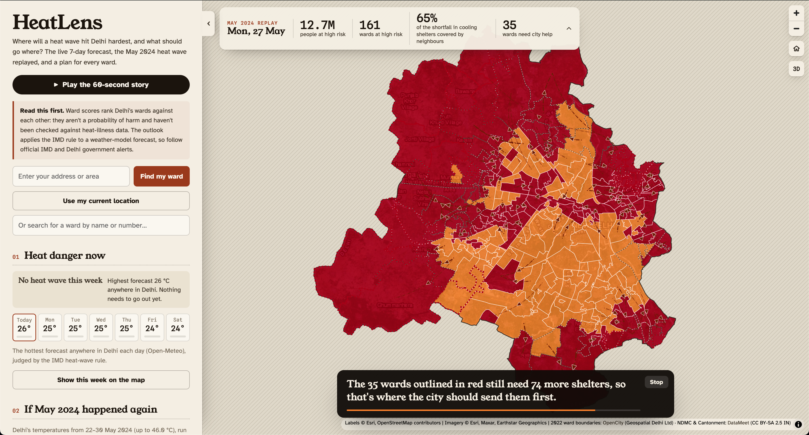
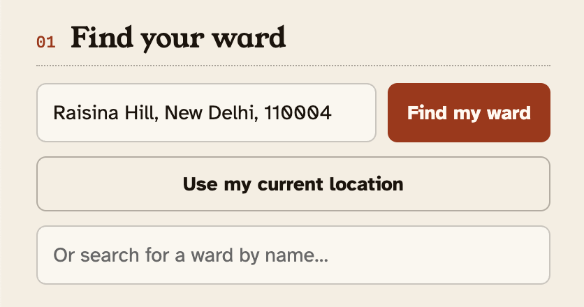

# HeatLens
HeatLens is a heat-assessment app which allows people to see regions that are most vulnerable to extreme heat. 
Built for EvoHacks 2
## Problem
Many regions around the world are at high risk of death or injury from heat waves. Delhi, the capital of India, is one of them. Places with less access to drinking water, hospitals, greenery, and good infrastructure are more vulnerable during a heat wave.

Currently, there exist systems to predict extreme heat, yet no system works to predict which regions are impacted the most by this heat. We wanted to build a tool that shows where help is needed first, and what help to send.
## Why Delhi?
India is one of the regions most at risk from extreme heat. Delhi, its capital, shows this risk well. It is a large, dense city where neighborhoods differ a lot in water access, greenery, crowding, and infrastructure.

Delhi is the proof of concept for HeatLens. We built and tested the full method in one city. In the future, the same method can be applied to other cities and countries.
## Solution
HeatLens identifies which regions are most vulnerable during a heat wave. It allows users to view different parts of Delhi. For each part, HeatLens determines how vulnerable the region is, shows the reasons, and lists the aid that the region needs.
## Key Features: 
* Risk Factor Detection: Our ranking algorithm determines which regions are most vulnerable, and shows the reasons for each score.
* Live Heat Map: The map shows 7-day forecast risk for every ward.
* User Location: Find your ward by address or current location, or search by ward name or number.
* May 2024 Replay: See what the real May 2024 heat wave would do to each ward today.
* "What to Send" Plan: For each ward, HeatLens lists the ORS points, outreach teams, water points, medical units, and cooling shelters that are needed, what the ward has, what neighbors can lend, and what the city must send.
* Neighbors Help First: Wards with spare cooling shelters lend them to nearby wards. The map outlines in red the wards that still lack shelters.
* 3D View: Each ward rises by how crowded it is and how much danger it faces. The tallest wards hold the most people in the heat.
* 60-Second Guided Story: A narrated guide for new users.

## Preview
Screenshot of the application on a day with no heat waves. The UI is on the left hand side, and you can look up wards and view information that determines risk level. 

Screenshot of the application during a heat wave. For this example, data from the May 2024 Delhi heat wave is used. 

During a heat wave, it also shows the most crowded regions in 3D to better showcase which regions are most at risk.

Screenshot of a specific region being selected. On the left hand side information that determines the risk level is displayed

The generated draft report that the application generates on heatwaves. It allows officals and first responders to know what to bring and where.

The maps also shows where to send supplies using arrows. 

The interace used to look up wards

### Who can use it 
Planners and officials can use HeatLens to decide where to send water, cooling, and medical aid first, and how much. Community groups can use it to find the areas that need the most support.

## How to run
Clone the repository, and then open app/index.html in a web browser.

## Limitations
The ranking has not been compared with real heat-illness or death records, because ward-level health data for Delhi is not publicly available. Instead we checked it against the wards named in the Delhi Heat Action Plan 2025 and a CSE study. The ranking is also relative, so “Extreme” just means that a ward is vulnerable compared to all the other ones in Delhi. Some of the data is old or estimated, and the weather forecast is not an official heat wave warning.

## How it works
We took data about population density, water access, healthcare access, and shaded regions along with other parameters and made a program that ranks how vulnerable each of Delhi’s 250 wards is during a heat wave. HeatLens then combines that ranking with a live weather forecast that can tell the user if a heatwave is coming, and how much risk it poses based on where the user lives.

1. 	Collecting the data
For every ward, we collected 14 indicators from free public datasets, categorized into 4 groups.

    | Group | What it measures | Indicators | Data sources | Riskier when… |
    | :--- | :--- | :--- | :--- | :--- |
    | **Heat hazard** | How hot a ward gets | • Ground surface temperature • Number of clear days with surface temperature above 45°C • Share of the ward that is paved or roofed | Landsat 8 & 9 satellites (2019–2025) ESA WorldCover | The ground gets hotter, more days pass 45°C, and more of the ward is paved or roofed |
    | **Exposure** | How many people the heat reaches | • Population density • Number of residents | WorldPop 2020 | More people live in the ward, and they live closer together |
    | **Sensitivity** | How many people are especially vulnerable | • Share of people under age 5 • Share of people above age 65 • Crowding • Temporary/one-room housing | WorldPop 2020 2011 Census | There are more young children and older adults, more crowding, and more temporary or one-room homes |
    | **Ability to cope** | How well people can protect themselves | • Travel time to the nearest hospital • Hospitals per 100,000 people • Tree cover • Household assets • Number of homes with treated tap water | OpenStreetMap ESA WorldCover 2011 Census | Hospitals are farther away or scarcer, and there is less tree cover, fewer household assets, and fewer homes with treated tap water |

2.	Scoring each ward.
Each of the 14 indicators is turned into a rank among the wards, with 0 meaning least at risk and 100 meaning most at risk. The indicators in each group are averaged into a group score. The four groups each make up an equal amount toward the final 0-100 vulnerability score for each ward. These scores then place all the wards into 5 equal sized classes, low, moderate, high, very high, and extreme.

3.	Checking the rankings
The final rankings were compared with the wards named in the Delhi Heat Action Plan 2025 and a Centre for Science and Environment (CSE) study. Wards that those reports call “high-risk” rank above the wards that the CSE call low heat stress in 94% of pairs.

4.	Adding the weather forecast
HeatLens gets a 7-day forecast from Open-Meteo for the user’s location or a ward that they pick. Each day is checked against the India Meteorological Department (IMD) heat-wave rule, which states that it must be at least 40C and at least 4.5C above Delhi’s normal for that date, or at least 45C for 2 or more dates in a row. The hottest forecast day is combined with the ward’s vulnerability class to give the risk level. The map colors every ward by this risk level, and a demo mode replays the real May 2024 Delhi heat wave.

5. 	Planning what to sendFor each ward, HeatLens lists the aid it needs: ORS points, outreach teams, water points, medical units, and cooling shelters. It then checks what the ward already has. Wards with spare cooling shelters lend them to the wards next door. The wards that still lack shelters are outlined in red. In the May 2024 replay, neighbors cover 65% of the shortfall, and 35 wards need 74 more shelters from the city.

## What’s Next?
HeatLens is currently a proof of concept. The next step is to apply the same method to other at-risk cities and countries. Additionally, we plan to develop it into a full scale application, not just a website. 
